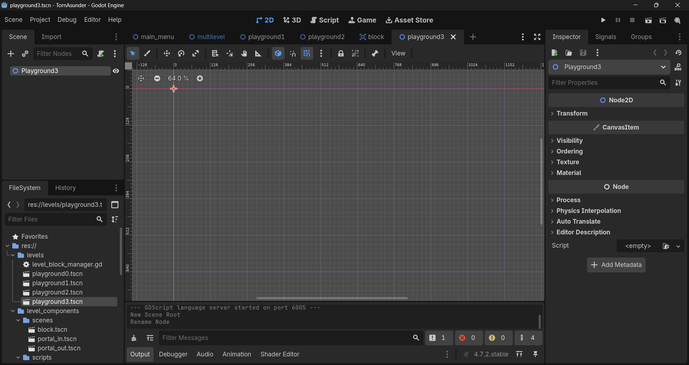
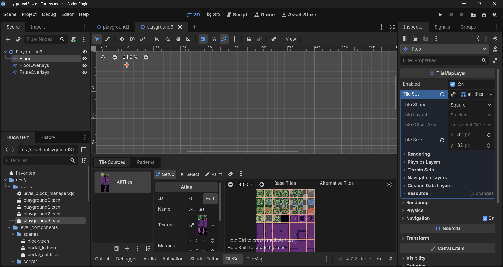
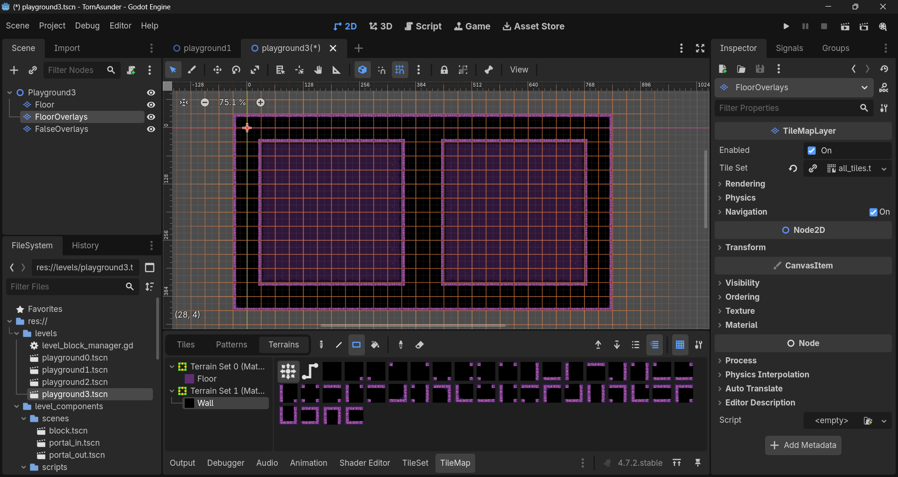
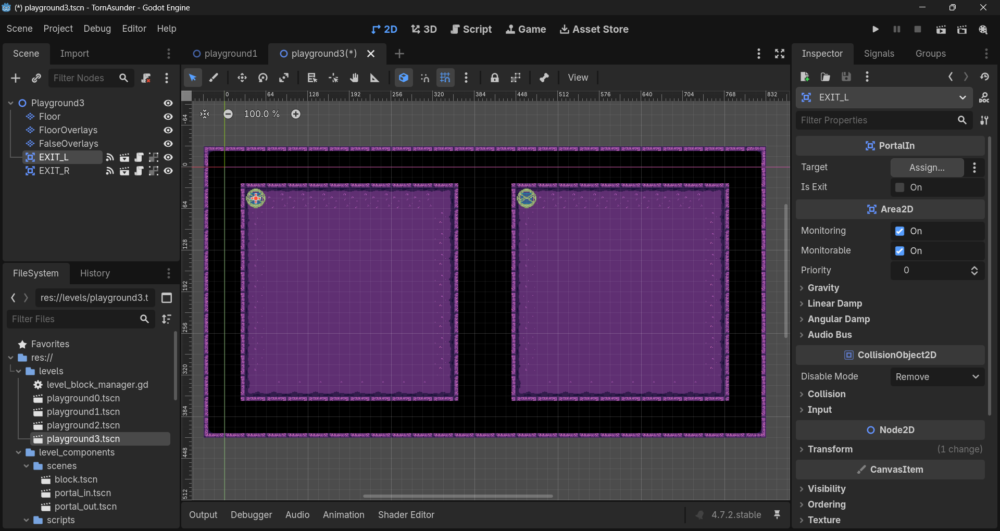
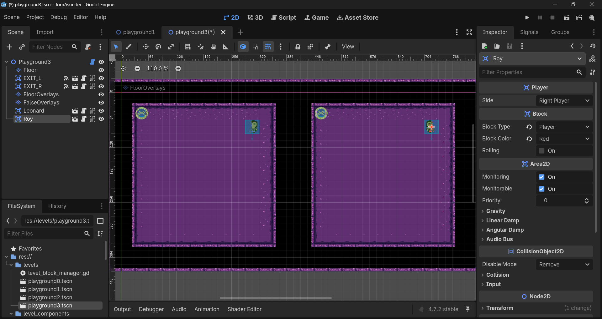
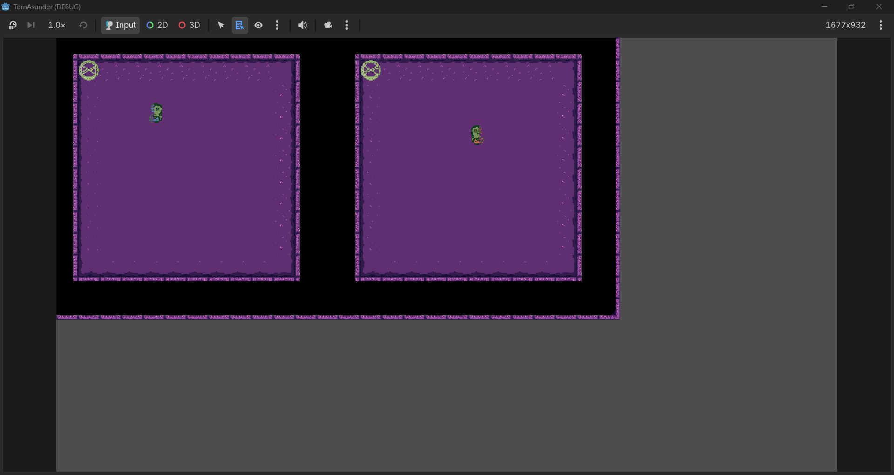

# 1. Creating a level scene

1. Create a new scene with a Node2D base. Save the scene in the `TornAsunder/levels` folder.

2. Add three TileMapLayer nodes named `Floor`, `FloorOverlays`, and `FalseOverlays` (in that order). In the inspector, set each of them to use the Tile Set `TornAsunder/all_tiles.tres`.

3. Select the `Floor` node from the scene tree, select its `TileMap` tab from the dock at the bottom of the screen, and switch to the `Terrains` page of that tab. Select the purple `Floor` terrain and, making sure that the "Connect mode" tile is selected (the eight arrows), draw two floor regions in the scene. A good rule of thumb is for the regions to be about 10x10. Make sure to leave a 1-tile gap between the floors and the axes.

4. Select the `FloorOverlays` node from the scene tree, select its `Wall` terrain, and fill the map border with "Connect mode" - the surrounding wall should be 2 tiles thick, with a 3-tile gap between the two maps.

5. Instace the `portal_in.tscn` scene twice, creating two nodes with names `EXIT_L` and `EXIT_R` (the names are important!). Place one in the left map and one in the right map.

6. In the scene tree, put the portals between `Floor` and `FloorOverlays`. Then, for each portal, use in Inspect menu to turn on the `Is Exit` property.

7. Create two instances of `block.tscn` called `Leonard` and `Roy` and place them after the `TileMapLayer` nodes in the scene tree. Move the blocks to the desired starting locations in the viewport.

8. In the inspector, set Leonard and Roy to have `Block Type` of `Player`. This change will not yet be reflected in the sprites.

9. Select the root node from the inspector and use the "Add Script" button to attach the `TornAsunder/levels/level_block_manager.gd` script to the level. This will open the script editor. Switching back to the 2d editor, you will see that nothing has changed yet, but that a blue script icon is now visible on the root node.

10. Reload Godot, either by closing and re-opening the project or using the `Project > Reload Current Project` toolbar item. The players will now have their new sprites assigned automatically.

11. Using the Inspector tab, set Leonard to have `Block Color` of `Blue` and Roy to have `Block Color` of `Red`. Also switch Roy to have `Side` of `Right Player`. Now that the block-managing "tool" script is watching the level, it will automatically update the sprites.

12. Open `res://scripts/multilevel.gd` and add the path to your level scene to the `level_paths` array.

13. Your level is now playable from the `res://scenes/multilevel.tscn` scene! (Viewport settings may be adjusted after the writing of this tutorial.)
